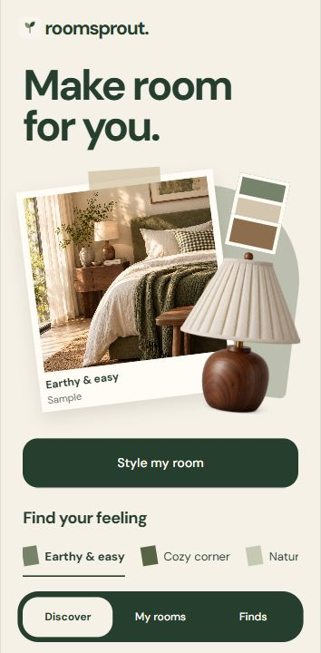
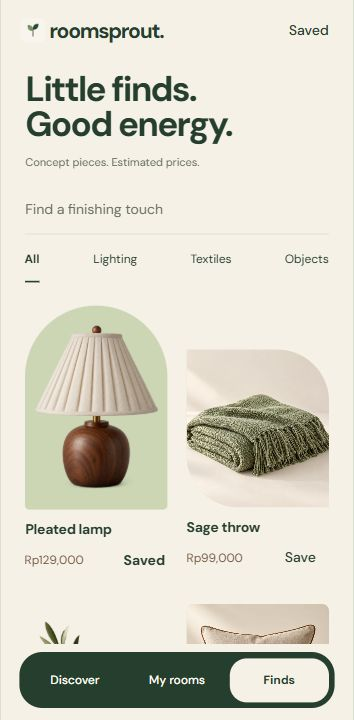

# RoomSprout

Your room. More you.

An English-language Expo / React Native prototype with a green, brown, and cream palette, original room imagery, and a companion landing page prepared for Vercel.

## Work in progress

RoomSprout is an ongoing product at the interactive prototype stage. The current app supports local room drafts, reference photos and clips, style and budget choices, editable decor mixes, and shopping searches. Real AI styling, live product matching, accounts, signed app distribution and production deployment are upcoming work.

### Current app

Screenshots captured from the running web prototype on 29 October 2026.

<p>
  
  
</p>

[Room setup and plan workspace](docs/screenshots/ux-prototype.png) · [UX decisions](docs/UX.md)

## Run

```sh
npm ci
npm start
```

Open the project in an SDK-compatible Expo Go app or a development build. Use `npm run web` for the web development server. Native camera behavior still requires a real device check.

```sh
npm run build:web
npm run preview
```

- Website: `http://127.0.0.1:4173/`
- Interactive app: `http://127.0.0.1:4173/studio`

## Included

- The approved tactile creative-studio design, with three main studio destinations.
- One resumable setup workspace for room references, style, name and budget.
- Guided photos and compressed local reference previews; silent native clip capture and muted clip selection/preview.
- Editable room plans, budget-aware item mixes, live estimated totals and a clear Done action.
- Undo for room, photo, item and bookmark removal; local drafts and saved plans.
- Search, intersecting catalog filters, meaningful empty states and contextual product details.
- Explicit Shopee/Tokopedia search destinations and a Vercel-ready landing page.

[UX research and decisions](docs/UX.md) map the work to Shneiderman's eight rules.

## Prototype boundaries

Styling is explicitly sample styling. There is no AI inference, remote photo upload, account, room measurement, live product catalog, checkout or affiliate system. Named rooms, drafts, selected items, favorites and bounded compressed JPEG references persist in AsyncStorage on this device. Camera originals are not uploaded. Clips remain in their current session and have an explicit replacement path after reload; room plans persist independently. Clearing app/browser storage removes the local collection.

Silent camera recording uses no microphone permission. Web users choose a clip from their library. Physical camera permissions, native playback and signed installation still require device verification.

Room/product imagery is conceptual. Prices are estimates, and marketplace links search for similar items. The website does not pretend signed app downloads exist.

## Does it need a database?

This milestone does not. Local state plus AsyncStorage covers the prototype. A real AI integration requires a server-side endpoint to protect API keys and enforce request limits, but a database is not inherently required for a first stateless analysis request. Add a database and private object storage when introducing accounts, cross-device room history, catalog administration, or paid usage. Establish retention and deletion rules before uploading personal room photos.

## Verification

```sh
npm run check
npx expo-doctor
npm run build:web
npm run preview
npx playwright install chromium
npm run test:browser
```

The browser check uses `http://127.0.0.1:4173` by default. Override `ROOMSPROUT_URL` for another server. If using installed Chrome, set `ROOMSPROUT_BROWSER_CHANNEL=chrome`. Screenshots go to `docs/screenshots/`. The test browser uses a separate temporary profile.

`npm test` covers catalog logic, migration, independent room identities, draft/reference round trips, invalid stored data, affordability and serialized write recovery. The browser suite covers the room, media, editing, undo, catalog and recovery journeys in an isolated profile. See docs/VERIFICATION.md for what actually ran.

## Vercel

Import `medissl/room-sprout`, select framework **Other**, and use the repository root. `vercel.json` sets the build command to `npm run build:web`, exports `dist`, and provides SPA rewrites. No environment variables are needed for this prototype. Confirm the target project and environment before publishing. App-store links should be added only after signed builds are actually available.

## Expo delivery

`eas.json` includes development, internal preview (Android APK), and production profiles. The bundle IDs are proposed identifiers and must be confirmed before the first store submission. EAS account/project linking, signing, and store releases have not been performed.

## Current dependency advisories

The installed Expo 58 toolchain reports five high-severity npm audit findings involving Expo CLI, its signing-certificate dependency, `node-forge`, and `zod`. At implementation time npm proposed a downgrade to Expo 44 rather than a compatible fix. No forced downgrade or incompatible major override was applied. These findings remain open and must be reassessed before publishing or signing production builds; they are not resolved by the successful Expo compatibility checks.

## Next milestone

Validate capture, permissions and accessibility on a physical phone, then connect one secure photo-to-recommendation endpoint with consent, request limits, cost handling and a trustworthy product source. Signed distribution and Vercel publication require authorization.
